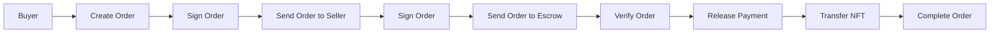

# MermaidMuse

A modern, AI-powered diagram editor for creating beautiful Mermaid diagrams. Built with Vite, React, TypeScript, and Mermaid.

## 🎯 Project Status

**AI-First Architecture**: Production-ready with AI diagram generation, fixing, and analysis features. Deployed on Cloudflare Pages + Workers.

## 🚀 Features

- **AI-Powered**: Generate diagrams from natural language, fix syntax errors, and get intelligent suggestions
- **Fast & Responsive**: Vite for instant HMR and lightning-fast builds
- **Mermaid Diagrams**: Create flowcharts, sequence diagrams, and all 15 supported diagram types
- **Monaco Editor**: Professional code editor with syntax highlighting
- **Interactive Preview**: Real-time diagram rendering with zoom (up to 800%), pan, and double-click zoom
- **Export Options**: PNG and JSON export formats
- **Credits System**: 10 free credits, then affordable top-ups for AI features
- **Theme System**: Multiple built-in themes with pluggable custom themes
- **Tailwind CSS**: Modern, clean styling
- **Type Safe**: Full TypeScript support with strict type checking
- **Code Quality**: ESLint and Prettier configured

## 📋 Prerequisites

- Node.js 18+
- npm or yarn

## 🔧 Installation

1. Clone the repository:

```bash
git clone https://github.com/lsj5031/MermaidMuse.git
cd MermaidMuse
```

2. Install dependencies:

```bash
npm install
```

3. Create environment configuration:

```bash
cp .env.example .env.local
```

4. Update `.env.local` with your configuration:

```env
# AI Provider (choose one: Groq recommended for free usage)
OPENAPI_API_KEY=your_api_key_here
OPENAPI_MODEL=gpt-4o
OPENAPI_BASE_URL=https://api.openai.com/v1

# Authentication (required for credits)
CLERK_SECRET_KEY=sk_...
VITE_CLERK_PUBLISHABLE_KEY=pk_...

# Payments (optional, for credit top-ups)
STRIPE_SECRET_KEY=sk_test_...
VITE_STRIPE_PUBLISHABLE_KEY=pk_test_...
STRIPE_WEBHOOK_SECRET=whsec_...
```

For detailed setup instructions, see [DEPLOYMENT.md](./DEPLOYMENT.md).

## 📖 Available Scripts

### Development

```bash
npm run dev              # Start dev server at :5173
npm run dev:workers     # Start Workers dev server at :8787
```

### Build & Deploy

```bash
npm run build           # Production build to dist/
npm run build:workers   # Dry-run Workers deployment
npm run deploy:workers  # Deploy Workers to Cloudflare
npm run preview         # Serve production build locally
```

### Code Quality

```bash
npm run lint            # Check for issues
npm run lint:fix       # Auto-fix issues
npm run format          # Format all files
npm run type-check      # Check TypeScript types
```

### Testing

```bash
npm run test            # Run tests
npm run test:watch      # Watch mode
```

For detailed development guide, see [DEVELOPMENT.md](./DEVELOPMENT.md).

## 🎨 Project Structure

```
src/
├── components/
│   ├── AIAssistant/           # AI features (generate, analyze, refine)
│   ├── layout/               # Layout components (header, editor, preview)
│   ├── editor/               # Monaco editor panel
│   ├── preview/              # Mermaid diagram rendering
│   └── ...
├── hooks/                   # Custom React hooks
├── theme/                   # Theme system and color palettes
├── utils/                   # Helper functions and API clients
├── server/                  # Server-side AI logic
├── workers/                 # Cloudflare Workers entrypoint
├── App.tsx                  # Root component
├── main.tsx                 # Entry point
└── index.css                # Global styles
```

## 🎨 Theme System

MermaidMuse includes a pluggable theme system with multiple built-in themes:

- **Light**: Clean, high-contrast for presentations
- **Dark**: Dark theme for reduced eye strain
- **Cyber**: Cyberpunk aesthetic with neon colors
- **Custom**: Register your own themes via API

See [THEME_SYSTEM.md](./THEME_SYSTEM.md) for complete theming documentation.

## 🤖 AI Features

- **AI Generate**: Create diagrams from natural language (2 credits)
- **AI Fix**: Automatically fix syntax errors (1 credit)
- **AI Assistant**: Real-time analysis and suggestions (1 credit)
- **AI Refinement**: Iterative diagram improvements (1 credit)

See [AI_FEATURES.md](./AI_FEATURES.md) for complete AI documentation.

## 📦 Key Dependencies

### Core

- **React 18**: UI library
- **TypeScript**: Type safety
- **Vite**: Build tool and dev server

### AI & API

- **OpenAPI-compatible**: Support for OpenAI, Groq, LocalAI, Ollama
- **Clerk**: User authentication and credits management
- **Stripe**: Payment processing for credit top-ups

### Editors & Visualization

- **Mermaid**: Diagram rendering (15 diagram types)
- **@monaco-editor/react**: Professional code editor
- **html2canvas**: PNG export functionality

### Styling

- **Tailwind CSS**: Utility-first CSS framework
- **PostCSS**: CSS processing

### Development

- **ESLint**: Code linting
- **Prettier**: Code formatting
- **Vitest**: Testing framework

## 🔐 Environment Variables

Create a `.env.local` file (use `.env.example` as template):

```env
# AI Provider (choose one: Groq recommended for free usage)
OPENAPI_API_KEY=your_api_key_here
OPENAPI_MODEL=gpt-4o
OPENAPI_BASE_URL=https://api.openai.com/v1

# Authentication (required for credits)
CLERK_SECRET_KEY=sk_...
VITE_CLERK_PUBLISHABLE_KEY=pk_...

# Payments (optional, for credit top-ups)
STRIPE_SECRET_KEY=sk_test_...
VITE_STRIPE_PUBLISHABLE_KEY=pk_test_...
STRIPE_WEBHOOK_SECRET=whsec_...
```

Only variables prefixed with `VITE_` are exposed to the client. All other variables are used by the Cloudflare Worker.

## 🚀 Deployment

### Quick Start

For a complete 10-minute deployment guide, see [DEPLOYMENT.md](./DEPLOYMENT.md).

### Cloudflare Pages + Workers (Recommended)

```bash
npm run deploy:workers
```

**Advantages**:

- Unified deployment (Pages for frontend, Workers for API)
- Global edge network for low latency
- Free tier: 100,000 requests/day
- Simple environment variable management

### Environment Variables in Production

Set these in your deployment platform:

**Required for AI Features**:

```env
OPENAPI_API_KEY=your-api-key
OPENAPI_MODEL=gpt-4o
OPENAPI_BASE_URL=https://api.openai.com/v1
```

**Required for Authentication**:

```env
CLERK_SECRET_KEY=sk_...
VITE_CLERK_PUBLISHABLE_KEY=pk_...
```

**Optional for Payments**:

```env
STRIPE_SECRET_KEY=sk_test_...
VITE_STRIPE_PUBLISHABLE_KEY=pk_test_...
STRIPE_WEBHOOK_SECRET=whsec_...
```

### AI Provider Options

| Provider | Cost     | Speed          | Setup |
| -------- | -------- | -------------- | ----- |
| **Groq** | **Free** | ⚡⚡⚡ Fastest | Easy  |
| OpenAI   | $$$      | ⚡⚡ Fast      | Easy  |
| LocalAI  | Free     | ⚡ Medium      | Hard  |
| Ollama   | Free     | ⚡ Slow        | Easy  |

For provider setup details, see [OPENAPI_PROVIDERS.md](./OPENAPI_PROVIDERS.md).

## 💡 Usage Examples

### Creating a Diagram with AI

1. Start dev server: `npm run dev`
2. Click "Generate with AI" in the editor
3. Describe your diagram: "User signup flow with email verification"
4. AI generates complete Mermaid code automatically

### Manual Diagram Creation

1. Edit Mermaid syntax in the left editor panel
2. See real-time preview in the right panel
3. Use "Fix with AI" to correct syntax errors

### Sample Diagram



## 🔗 Useful Resources

### Documentation

- [AI Features Overview](./AI_FEATURES.md) - Complete AI feature documentation
- [Deployment Guide](./DEPLOYMENT.md) - Step-by-step deployment instructions
- [Migration Guide](./MIGRATION.md) - API provider and architecture migration
- [Development Guide](./DEVELOPMENT.md) - Local development setup
- [Theme System](./THEME_SYSTEM.md) - Custom theme creation
- [AI Providers](./OPENAPI_PROVIDERS.md) - Provider comparison and setup

### External Resources

- [Mermaid Documentation](https://mermaid.js.org)
- [Vite Documentation](https://vitejs.dev)
- [React Documentation](https://react.dev)
- [TypeScript Documentation](https://www.typescriptlang.org)
- [Tailwind CSS Documentation](https://tailwindcss.com)

## 🐛 Troubleshooting

### Common Issues

**Port Already in Use**: Vite automatically uses the next available port.

**Mermaid Not Rendering**: Check syntax validity and clear browser cache.

**AI Features Not Working**: Verify API keys and credits balance.

**TypeScript Errors**: Run `npm run type-check` for detailed errors.

## 🤝 Contributing

1. Create a feature branch
2. Make changes and test locally
3. Run quality checks: `npm run lint && npm run type-check && npm run format`
4. Submit a pull request

## 📄 License

MIT License

---

**Happy AI-powered diagramming! 🎨✨**
