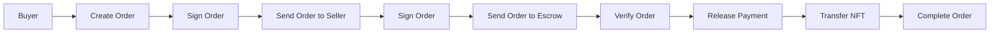

# MermaidMuse

A modern, minimalist diagram editor for creating beautiful Mermaid diagrams. Built with Vite, React, TypeScript, and Mermaid.

## 🎯 Project Status

**Frontend-only MVP**: Currently deploying the frontend to Cloudflare Pages. No backend required for basic functionality.

## 🚀 Features

- **Fast & Responsive**: Vite for instant HMR and lightning-fast builds
- **Mermaid Diagrams**: Create flowcharts, sequence diagrams, and other visualizations
- **Monaco Editor**: Professional code editor with syntax highlighting
- **Interactive Preview**: Real-time diagram rendering with zoom (up to 800%), pan, and double-click zoom
- **Export Options**: PNG and JSON export formats
- **Tailwind CSS**: Modern, clean styling
- **Type Safe**: Full TypeScript support with strict type checking
- **Code Quality**: ESLint and Prettier configured

## 📋 Prerequisites

- Node.js 18+
- npm or yarn

## 🔧 Installation

1. Clone the repository:

```bash
git clone https://github.com/lsj5031/MermaidMuse.git
cd MermaidMuse
```

2. Install dependencies:

```bash
npm install
```

3. Create environment configuration:

```bash
cp .env.example .env.local
```

4. Update `.env.local` with your configuration:

```env
# Client-side (exposed to the browser)
VITE_API_URL=http://localhost:3000
VITE_STRIPE_PUBLISHABLE_KEY=pk_test_your_key_here
VITE_MOCK_PRO=false

# Server-side (used by /api/fix with OpenAPI-compatible endpoints)
# Supports OpenAI, Groq, or any OpenAI-compatible API
OPENAPI_API_KEY=your_api_key_here
OPENAPI_MODEL=gpt-4o
OPENAPI_BASE_URL=https://api.openai.com/v1
```
## 📖 Available Scripts

### Development

```bash
npm run dev
```

Starts the development server at `http://localhost:5173`

### Development with Cloudflare Workers

```bash
npm run dev:workers
```

Starts the Cloudflare Workers development environment for testing serverless functions locally.

### Build

```bash
npm run build
```

Creates an optimized production build in `dist/`

### Build for Cloudflare Workers

```bash
npm run build:workers
```

Creates a dry-run deployment package for Cloudflare Workers.

### Deploy to Cloudflare

```bash
npm run deploy:workers
```

Deploys the serverless functions to Cloudflare Workers.

### Preview

```bash
npm run preview
```

Serves the production build locally for testing

### Linting & Formatting

```bash
npm run lint              # Check for issues
npm run lint:fix         # Auto-fix issues
npm run format           # Format all files
npm run format:check     # Check if formatting is needed
npm run type-check       # Check TypeScript types
```

### Tests

```bash
npm run test            # Run tests
npm run test:watch      # Watch mode
```

## 🎨 Project Structure

```
src/
├── components/
│   ├── layout/
│   │   ├── HeaderModern.tsx      # Top navigation bar
│   │   ├── EditorModern.tsx      # Code editor panel
│   │   ├── PreviewModern.tsx     # Diagram preview with zoom/pan
│   │   └── MainContent.tsx       # Main layout container
│   ├── ProUpsell/                # Pro feature teasers
│   └── ...
├── hooks/
│   └── useDiagramState.tsx       # Global diagram state management
├── theme/
│   ├── colors.ts                 # Color palette
│   └── constants.ts              # App constants
├── utils/
│   ├── exportHelpers.ts          # Export functions (PNG, JSON)
│   ├── environmentHelpers.ts     # Environment configuration
│   └── validationHelpers.ts      # Input validation
├── App.tsx                        # Root component
├── main.tsx                       # Entry point
└── index.css                      # Global styles
```

## 🌈 Cyberpunk Theme

The application includes a custom cyberpunk-inspired color scheme:

- **Primary Colors**: Neon pink (#ff006e), cyan (#00f5ff), purple (#b537f2)
- **Accent Colors**: Green (#39ff14), yellow (#fffd38), blue (#0080ff)
- **Dark Theme**: Dark backgrounds with light text for eye comfort

Customize colors in:

- `src/theme/colors.ts` - Color definitions
- `tailwind.config.js` - Tailwind theme configuration

## 📦 Key Dependencies

### Core

- **React 18**: UI library
- **TypeScript**: Type safety
- **Vite**: Build tool and dev server

### Editors & Visualization

- **Mermaid**: Diagram rendering
- **@monaco-editor/react**: Code editor
- **Three.js**: 3D graphics support
- **html2canvas**: Screenshot/export functionality

### Styling

- **Tailwind CSS**: Utility-first CSS framework
- **PostCSS**: CSS processing

### Payments

- **@stripe/stripe-js**: Stripe integration

### Development

- **ESLint**: Code linting
- **Prettier**: Code formatting

## 🔐 Environment Variables

Create a `.env.local` file (use `.env.example` as template):

```env
# Client-side (exposed to the browser)
VITE_API_URL=http://localhost:3000
VITE_STRIPE_PUBLISHABLE_KEY=pk_test_your_key_here
VITE_MOCK_PRO=false

# Server-side (used by serverless functions with OpenAPI-compatible endpoints)
# Supports OpenAI, Groq, or any OpenAI-compatible API
OPENAPI_API_KEY=your_api_key_here
OPENAPI_MODEL=gpt-4o
OPENAPI_BASE_URL=https://api.openai.com/v1
```

Only variables prefixed with `VITE_` are exposed to the client. `OPENAPI_*` variables are intended for serverless runtimes (Cloudflare Workers, Vercel Functions, or Netlify Functions).

## 🔌 Serverless API (`/api/fix`)

The API endpoint uses OpenAPI-compatible endpoints (e.g., OpenAI, Groq, or any compatible service).

- **POST** `/api/fix`
- **Body**: `{ "diagramText": "..." }`
- **Response**: `{ ok, fixedText, suggestions, error? }`

Example:

```bash
curl -s http://localhost:8888/api/fix \
  -H 'Content-Type: application/json' \
  -d '{"diagramText":"graph TD\nA -->"}' | jq
```

Local notes:

- Vite's dev server does **not** run serverless functions.
- To run Cloudflare Workers locally, use `npm run dev:workers`.
- To run Netlify/Vercel functions locally, use `netlify dev` or `vercel dev` respectively.
## 🚀 Deployment

### Cloudflare Pages (Recommended)

The project includes a GitHub Actions workflow for automatic deployment to Cloudflare Pages.

**Setup:**

1. Connect your GitHub repository to Cloudflare Pages
2. Configure build settings:
   - **Build command**: `npm run build`
   - **Build output directory**: `dist`
3. Add GitHub secrets:
   - `CLOUDFLARE_API_TOKEN` - [Generate here](https://dash.cloudflare.com/profile/api-tokens)
   - `CLOUDFLARE_ACCOUNT_ID` - Find in Cloudflare Dashboard
4. Every push to `main` automatically deploys

See `.github/workflows/deploy.yml` for workflow configuration.

### Manual Deployment

```bash
npm run build
```

The `dist/` directory is ready to be deployed to any static hosting provider.

### Cloudflare Pages + Workers (Recommended)

```bash
npm run deploy:workers
```

This repo includes `wrangler.toml` for Cloudflare Workers configuration:

1. **Prerequisites**: Create a Cloudflare account and install Wrangler CLI
2. **Setup**: Configure your `account_id` and other settings in `wrangler.toml`
3. **Deploy**: Run `npm run deploy:workers`
4. **Environment Variables**: Set `OPENAPI_API_KEY`, `OPENAPI_MODEL`, `OPENAPI_BASE_URL` in Cloudflare dashboard

**Advantages**:

- Unified deployment (Pages for frontend, Workers for serverless functions)
- Global edge network for low latency
- Simple environment variable management
- Free tier available

### Vercel

- This repo includes `vercel.json` for SPA routing + `/api/*` preservation.
- Add the environment variables listed below.
- Deploy via the Vercel dashboard (Import Project) or CLI (`vercel`).

### Netlify

- This repo includes `netlify.toml` which:
  - publishes `dist/`
  - redirects `/api/*` to `/.netlify/functions/*`
  - provides an SPA fallback to `/index.html`
- Add the environment variables listed below.

### Custom domain steps (high level)

1. Deploy once on your platform.
2. In the platform dashboard, add your domain (e.g. `app.example.com`).
3. Update DNS:
   - **Subdomain**: CNAME to the platform-provided hostname
   - **Apex/root**: use A/ALIAS/ANAME records as instructed by the platform
4. Wait for DNS + TLS to provision, then set the domain as the primary.

### Environment Variables in Production

Set these in your deployment platform's environment variable settings:

**Client-side (exposed to browser)**:

- `VITE_API_URL` (optional)
- `VITE_STRIPE_PUBLISHABLE_KEY` (client-side upsell teaser)

**Server-side (for serverless functions)**:

- `OPENAPI_API_KEY` (required for `/api/fix`)
- `OPENAPI_MODEL` (optional, defaults to `gpt-4o`)
- `OPENAPI_BASE_URL` (optional, defaults to `https://api.openai.com/v1`)

**Legacy Support** (still works but not recommended):

- `XAI_API_KEY` (falls back if `OPENAPI_API_KEY` not set)
- `XAI_MODEL` (falls back if `OPENAPI_MODEL` not set)
- `XAI_BASE_URL` (falls back if `OPENAPI_BASE_URL` not set)

## 💡 Usage Examples

### Creating a Diagram

1. Start dev server: `npm run dev`
2. Edit Mermaid syntax in the left editor panel
3. See real-time preview in the right panel

### Preview Controls

- **Zoom In/Out**: Click buttons or scroll wheel
- **Double-click**: Zoom in by 50%
- **Drag**: Pan around the diagram
- **Reset**: Click reset button to return to 100% zoom

### Sample Diagram




## 🔗 Useful Resources

- [Mermaid Documentation](https://mermaid.js.org)
- [Vite Documentation](https://vitejs.dev)
- [React Documentation](https://react.dev)
- [TypeScript Documentation](https://www.typescriptlang.org)
- [Tailwind CSS Documentation](https://tailwindcss.com)

## 🐛 Troubleshooting

### Port Already in Use

Vite automatically uses the next available port if 5173 is in use.

### Mermaid Not Rendering

- Check diagram syntax is valid
- Clear browser cache (`Ctrl+Shift+Delete`)
- Check browser console for errors

### TypeScript Errors

```bash
npm run type-check
```

## 🤝 Contributing

1. Create a feature branch
2. Make changes and test locally
3. Run linting: `npm run lint && npm run type-check`
4. Format code: `npm run format`
5. Submit a pull request

## 🎯 Planned Features

- [ ] Backend API integration (when ready)
- [ ] User authentication
- [ ] Diagram persistence/library
- [ ] Diagram sharing
- [ ] Collaboration features
- [ ] Custom theme support
- [ ] AI-powered diagram suggestions

## 📄 License

MIT License

---

**Happy diagramming! 🎨**
