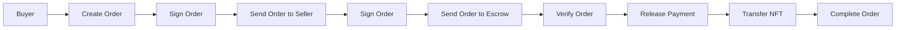

# MermaidMuse

A modern, minimalist Mermaid diagram editor with AI-powered syntax fixing. Built with Vite, React, TypeScript, and Mermaid.

## 🚀 Features

- **Fast & Responsive**: Vite for instant HMR and lightning-fast builds
- **Mermaid Diagrams**: All 15 diagram types supported (flowcharts, sequence, class, state, ER, Gantt, pie, mindmap, timeline, kanban, block, sankey, C4, git, user journey)
- **Monaco Editor**: Professional code editor with syntax highlighting
- **Interactive Preview**: Real-time diagram rendering with zoom (up to 800%), pan, and double-click zoom
- **AI Syntax Fixing**: Optional xAI/Grok-powered diagram syntax correction
- **Multiple Themes**: Avocado, Kanagawa, Dracula, and Solarized themes for diagram rendering
- **Export Options**: SVG export with customizable filenames
- **Tailwind CSS**: Modern, clean styling
- **Type Safe**: Full TypeScript support with strict type checking

## 📋 Prerequisites

- Node.js 18+
- npm or yarn

## 🔧 Installation

1. Clone the repository:

```bash
git clone https://github.com/lsj5031/MermaidMuse.git
cd MermaidMuse
```

2. Install dependencies:

```bash
npm install
```

## 📖 Available Scripts

### Development

```bash
npm run dev
```

Starts the development server at `http://localhost:5173`

### Build

```bash
npm run build
```

Creates an optimized production build in `dist/`

### Preview

```bash
npm run preview
```

Serves the production build locally for testing

### Linting & Formatting

```bash
npm run lint              # Check for issues
npm run lint:fix         # Auto-fix issues
npm run format           # Format all files
npm run format:check     # Check if formatting is needed
npm run type-check       # Check TypeScript types
```

### Tests

```bash
npm run test            # Run tests
npm run test:watch      # Watch mode
```

## 🎨 Project Structure

```
src/
├── components/
│   ├── layout/         # Header, Editor, Preview, MainContent
│   ├── editor/         # Monaco editor wrapper
│   └── preview/        # Mermaid preview panel
├── hooks/
│   └── useDiagramState.tsx   # Global diagram state management
├── theme/
│   ├── themeRegistry.ts      # Pluggable theme system
│   ├── defaultThemes.ts      # Built-in themes
│   └── constants.ts          # App constants
├── utils/
│   ├── exportHelpers.ts      # Export functions (SVG)
│   ├── environmentHelpers.ts # Environment configuration
│   └── validationHelpers.ts  # Input validation
├── server/
│   └── xaiFix.ts             # AI syntax fixing backend
├── App.tsx                   # Root component
├── main.tsx                  # Entry point
└── index.css                 # Global styles
```

## 🚀 Deployment

### Cloudflare Pages (Recommended)

The project includes a GitHub Actions workflow for automatic deployment to Cloudflare Pages.

**Setup:**

1. Connect your GitHub repository to Cloudflare Pages
2. Configure build settings:
   - **Build command**: `npm run build`
   - **Build output directory**: `dist`
3. Add GitHub secrets:
   - `CLOUDFLARE_API_TOKEN` - [Generate here](https://dash.cloudflare.com/profile/api-tokens)
   - `CLOUDFLARE_ACCOUNT_ID` - Find in Cloudflare Dashboard
4. Every push to `main` automatically deploys

See `.github/workflows/deploy.yml` for workflow configuration.

### Manual Deployment

```bash
npm run build
```

Deploy the `dist/` directory to any static hosting:
- Cloudflare Pages
- Vercel
- Netlify
- GitHub Pages
- AWS S3 + CloudFront

## 💡 Usage

### Creating a Diagram

1. Start dev server: `npm run dev`
2. Edit Mermaid syntax in the left editor panel
3. See real-time preview in the right panel

### Preview Controls

- **Zoom In/Out**: Click buttons or scroll wheel
- **Double-click**: Zoom in by 50%
- **Drag**: Pan around the diagram
- **Reset**: Click reset button to return to 100% zoom

### Sample Diagram



## 📦 Key Dependencies

- **React 18** - UI framework
- **TypeScript** - Type safety
- **Vite** - Build tool
- **Mermaid 11.12.2** - Diagram rendering (all 15 diagram types)
- **@monaco-editor/react** - Code editor
- **Tailwind CSS** - Styling
- **html2canvas** - PNG export
- **lucide-react** - Icons

## 🔗 Useful Resources

- [Mermaid Documentation](https://mermaid.js.org)
- [Vite Documentation](https://vitejs.dev)
- [React Documentation](https://react.dev)
- [TypeScript Documentation](https://www.typescriptlang.org)
- [Tailwind CSS Documentation](https://tailwindcss.com)

## 🤝 Contributing

1. Create a feature branch
2. Make changes and test locally
3. Run linting: `npm run lint && npm run type-check`
4. Format code: `npm run format`
5. Submit a pull request

## 📄 License

MIT License
