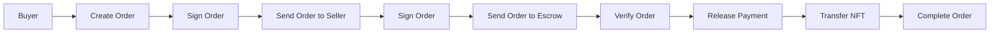

# MermaidMuse

A modern, minimalist diagram editor for creating beautiful Mermaid diagrams. Built with Vite, React, TypeScript, and Mermaid.

## 🎯 Project Status

**Frontend-only MVP**: Currently deploying the frontend to Cloudflare Pages. No backend required for basic functionality.

## 🚀 Features

- **Fast & Responsive**: Vite for instant HMR and lightning-fast builds
- **Mermaid Diagrams**: Create flowcharts, sequence diagrams, and other visualizations
- **Monaco Editor**: Professional code editor with syntax highlighting
- **Interactive Preview**: Real-time diagram rendering with zoom (up to 800%), pan, and double-click zoom
- **Export Options**: PNG and JSON export formats
- **Tailwind CSS**: Modern, clean styling
- **Type Safe**: Full TypeScript support with strict type checking
- **Code Quality**: ESLint and Prettier configured

## 📋 Prerequisites

- Node.js 18+
- npm or yarn

## 🔧 Installation

1. Clone the repository:

```bash
git clone https://github.com/lsj5031/MermaidMuse.git
cd MermaidMuse
```

2. Install dependencies:

```bash
npm install
```

## 📖 Available Scripts

### Development

```bash
npm run dev
```

Starts the development server at `http://localhost:5173`

### Build

```bash
npm run build
```

Creates an optimized production build in `dist/`

### Preview

```bash
npm run preview
```

Serves the production build locally for testing

### Linting & Formatting

```bash
npm run lint              # Check for issues
npm run lint:fix         # Auto-fix issues
npm run format           # Format all files
npm run format:check     # Check if formatting is needed
npm run type-check       # Check TypeScript types
```

### Tests

```bash
npm run test            # Run tests
npm run test:watch      # Watch mode
```

## 🎨 Project Structure

```
src/
├── components/
│   ├── layout/
│   │   ├── HeaderModern.tsx      # Top navigation bar
│   │   ├── EditorModern.tsx      # Code editor panel
│   │   ├── PreviewModern.tsx     # Diagram preview with zoom/pan
│   │   └── MainContent.tsx       # Main layout container
│   ├── ProUpsell/                # Pro feature teasers
│   └── ...
├── hooks/
│   └── useDiagramState.tsx       # Global diagram state management
├── theme/
│   ├── colors.ts                 # Color palette
│   └── constants.ts              # App constants
├── utils/
│   ├── exportHelpers.ts          # Export functions (PNG, JSON)
│   ├── environmentHelpers.ts     # Environment configuration
│   └── validationHelpers.ts      # Input validation
├── App.tsx                        # Root component
├── main.tsx                       # Entry point
└── index.css                      # Global styles
```

## 🚀 Deployment

### Cloudflare Pages (Recommended)

The project includes a GitHub Actions workflow for automatic deployment to Cloudflare Pages.

**Setup:**

1. Connect your GitHub repository to Cloudflare Pages
2. Configure build settings:
   - **Build command**: `npm run build`
   - **Build output directory**: `dist`
3. Add GitHub secrets:
   - `CLOUDFLARE_API_TOKEN` - [Generate here](https://dash.cloudflare.com/profile/api-tokens)
   - `CLOUDFLARE_ACCOUNT_ID` - Find in Cloudflare Dashboard
4. Every push to `main` automatically deploys

See `.github/workflows/deploy.yml` for workflow configuration.

### Manual Deployment

```bash
npm run build
```

Deploy the `dist/` directory to any static hosting:
- Cloudflare Pages
- Vercel
- Netlify
- GitHub Pages
- AWS S3 + CloudFront

## 💡 Usage

### Creating a Diagram

1. Start dev server: `npm run dev`
2. Edit Mermaid syntax in the left editor panel
3. See real-time preview in the right panel

### Preview Controls

- **Zoom In/Out**: Click buttons or scroll wheel
- **Double-click**: Zoom in by 50%
- **Drag**: Pan around the diagram
- **Reset**: Click reset button to return to 100% zoom

### Sample Diagram



## 📦 Key Dependencies

- **React 18** - UI framework
- **TypeScript** - Type safety
- **Vite** - Build tool
- **Mermaid** - Diagram rendering
- **@monaco-editor/react** - Code editor
- **Tailwind CSS** - Styling
- **html2canvas** - PNG export
- **lucide-react** - Icons

## 🔗 Useful Resources

- [Mermaid Documentation](https://mermaid.js.org)
- [Vite Documentation](https://vitejs.dev)
- [React Documentation](https://react.dev)
- [TypeScript Documentation](https://www.typescriptlang.org)
- [Tailwind CSS Documentation](https://tailwindcss.com)

## 🐛 Troubleshooting

### Port Already in Use

Vite automatically uses the next available port if 5173 is in use.

### Mermaid Not Rendering

- Check diagram syntax is valid
- Clear browser cache (`Ctrl+Shift+Delete`)
- Check browser console for errors

### TypeScript Errors

```bash
npm run type-check
```

## 🤝 Contributing

1. Create a feature branch
2. Make changes and test locally
3. Run linting: `npm run lint && npm run type-check`
4. Format code: `npm run format`
5. Submit a pull request

## 🎯 Planned Features

- [ ] Backend API integration (when ready)
- [ ] User authentication
- [ ] Diagram persistence/library
- [ ] Diagram sharing
- [ ] Collaboration features
- [ ] Custom theme support
- [ ] AI-powered diagram suggestions

## 📄 License

MIT License

---

**Happy diagramming! 🎨**
